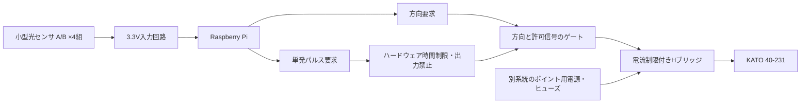

# Nゲージ実機制御回路 — 設計案 Rev.2

対象：KATO 40-231、Raspberry Pi、車両の加工を必要としない光学式検知。

**この文書は未通電の設計案です。製作・購入用の確定回路ではありません。**
40-231の12〜20V・約0.8〜1A・50〜100ms・青白2線という仕様は、利用者の提示と適用確認に基づきます。メーカー資料との照合・実機検証は未完了です。
12V試作回路、GPIO割当、RC定数の試算と検証手順は[ポイント駆動回路 Rev.1](turnout-driver.md)にまとめています。
コネクタは切断し、青白線を駆動回路の配線点へ直接はんだ付けする方針です。
GPIO出力コードはまだ実装していません。既存のアプリはシミュレーターのままです。

## 1. 構成

Hブリッジは、**メーカーが指定する2線式・極性反転・瞬時通電のポイントであると確認できた場合**の候補です。
40-231がこの方式に適合することを確認してから採用します。
一つの40-231に複数の転換部がある場合、その内部配線と指定の接続方法を確認し、独立に操作できる数を確定します。
ソフトウェアの4組と電気的な駆動回路の数は、現時点では同数と確定していません。

## 2. ポイント駆動回路の候補

候補はTI DRV8871搭載の、回路図と電流制限定数が公開されたHブリッジモジュールです。
DRV8871は一般に6.5〜45Vのモータ電源範囲を持つ製品ですが、これは**ポイントに加えてよい電圧ではありません**。
ポイント仕様、負荷のピーク電流、モジュールの熱条件、入力しきい値を資料で照合して採否を決定します。
3.6Aなどのピーク表示だけで連続電流能力を判断しません。

### 1駆動出力分の接続案

| 接続元 | 接続先 | 条件 |
|---|---|---|
| ポイント用DC電源＋ | ヒューズ → 非常停止用の保持型接点 → ドライバVM | 電圧・ヒューズ定格は未確定 |
| ポイント用DC電源− | ドライバGND | Pi GNDと共通接続する非絶縁案 |
| Pi GND | ロジック回路GND・ドライバGND | 負荷電流がPi側の細いGND線を流れない配線 |
| ドライバOUT1 / OUT2 | ポイントの指定された駆動端子 | レール給電端子に接続しない |
| Piの方向要求2本 | 3.3V ANDゲートの各入力 | GPIO番号は駆動系統数と回路確定後に割当 |
| ハードウェアの通電許可 | 上記ANDゲートの共通入力 | 電源投入時は必ずLOW |
| ANDゲートの出力2本 | ドライバIN1 / IN2 | ドライバの3.3V入力適合を確認 |

Pi、センサ、ロジックはポイント用電源から直接給電しません。
Piは機種に適合する電源を使います。ポイント負荷の大電流配線はPi・センサ配線から分けます。
ドライバ近傍のバイパスコンデンサ、バルク容量、逆接対策は採用モジュールの回路図とメーカー推奨に従います。
極性反転する負荷の両端に、単独のフライバックダイオードを並列接続してはいけません。

### 出力許可と保持時間

- GPIOの方向要求・トリガ入力には、候補値10kΩのプルダウンを設けます。最終値は入力仕様と照合します。
- 方向要求2本は同時に有効にしない制御とし、逆転前に両方をOFFにします。
- ロジックは、非再トリガ型のワンショット回路（74HC221系など）で許可時間を制限する案です。
- ON時間はポイントの指定条件で決定します。R/C値と電源投入時リセット回路は未設計です。
- 起動・再起動・GPIO解放・プログラム異常時はOFFになることを、ポイント未接続の状態で確認します。
- 連続リトリガやソフト故障による繰り返し通電は、ワンショット単独では防げません。再通電禁止時間と必要なハードウェアの再許可条件を別途設計します。
- 駆動出力がOFFになっても機械的なポイント位置は保持する想定ですが、実物で確認します。

## 3. 光センサの選択（更新）

発光・受光一体型の小型反射式モジュールを、架線柱から屋根へ向けて設置します。
車体まで約10mm、取付高さを調整可能とします。分離型透過式は採用しません。
Raspberry Pi 4 Model Bを基準とし、詳細は[センサ・Pi配線設計](sensor-design.md)を参照してください。

アナログ出力をADCで読み、8個それぞれの感度と検知・復帰時間を調整する構成です。
モジュールの型番、10mmでの検知余裕、屋根色と周辺光の影響は実物評価後に確定します。

## 4. 進路と駆動の規則

1. Aを検知してもポイント出力は動かしません。
2. LEDの交互表示もポイント出力と独立です。
3. B検知で進路を確定し、ロックと競合を確認してから必要な転換だけ要求します。
4. 前回位置と同じ進路なら、位置の信頼性が確認できる場合に限り再通電を省略します。
5. 起動時の位置は不明です。進路表示だけで転換完了とは扱いません。
6. パルス終了だけで機械的転換成功とは判定しません。位置確認または運転者の確認方法が必要です。
7. 転換中・未確認・異常時は信号を停止表示にします。
8. 最後尾の通過を確認するまで進路を解除しません。現在の試作は手動解除です。

## 5. 確定に必要な情報

- 利用者提示の40-231仕様を前提とする。コネクタ写真は不要。極性と転換方向は実物で確認。
- Raspberry Pi 4 Model Bを採用（機種変更時はGPIOヘッダ、SPI、電源条件を再確認）。
- 架線柱への取付可能寸法。屋根まで約10mm、上下調整式の条件で設計。
- 同時走行する列車数、最大編成長、通過確認を手動にするか。

## 6. 組立・検証の順序

1. メーカー仕様とポイント用の適合電源・駆動方式を確定する。
2. センサ1組だけを仮設し、実車両・外光・最低/最高速度で検知を記録する。
3. ポイントを接続せず、ドライバ出力の極性、パルス幅、電流制限、起動時OFF、異常時OFFを測る。
4. 適合する電源と保護回路でポイント1系統だけ試験し、確実な転換と発熱を確認する。
5. 転換確認・ロック解除・競合制御を検証した後に、他の系統へ展開する。

## 資料候補（この環境では本文を取得できていません）

- KATO公式製品情報： https://www.katomodels.com/ （40-231の説明書を優先）
- TI DRV8871： https://www.ti.com/lit/ds/symlink/drv8871.pdf
- Pololu QTR製品情報： https://www.pololu.com/category/123/pololu-qtr-reflectance-sensors

部品表、端子番号入り確定回路図、R/C値、電源定格は仕様確認後の次版で作成します。

最新の制御基板はIC・抵抗・コンデンサ・VRの表面実装50点を実装依頼する候補版です。コネクタ部品は使わず、電線直結用の穴を残します。LCSC調達の確定はネットワーク制限により未完了です。

## 追加基板の設計草案

- [ポイント駆動基板](driver-board/README.md)：100mm角・12V・DRV8871×4。回路図、部品表、未配線の配置案を作成。
- [センサバッファ基板](sensor-buffer/README.md)：100mm角・3.3V・MCP6004×2による8入力。回路図、部品表、未配線の配置案を作成。
- [架線柱センサ](sensor-module/README.md)：QTRX-HD-01A（最適距離10mm・幅約5mm）と上下調整式取付案。

両追加基板は配線・部品調達・熱設計前の草案です。ERC合格だけで発注できる状態ではありません。既存TC IO Rev Cは変更していません。
