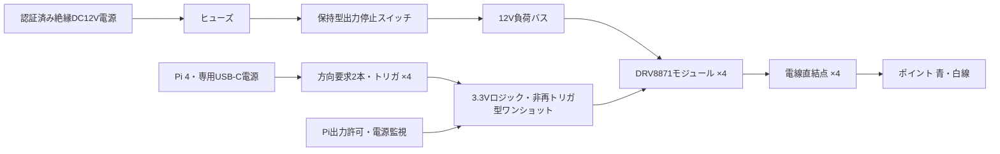

# KATO 40-231 ポイント駆動回路 Rev.1

## 設計の位置づけ

Raspberry Pi 4 Model B用の試作回路案です。最新の制御基板は表面実装50点（VR含む）・コネクタなしです。LCSC部品選定は接続制限で確認待ちです。製作前の部品資料照合・電気試験が必要で、実機出力コードはまだありません。
仕様の根拠は利用者からの提示・適用確認です。メーカー文書との独立した照合は未完了です。

| 項目 | 設計入力／採用案 |
|---|---|
| ポイント | KATO 40-231、ソレノイド式、青・白の2線 |
| 提示電圧 | 約12〜20V。試作は安定化DC12Vに限定 |
| 提示ピーク電流 | 約0.8〜1.0A |
| 提示抵抗 | 約20.5Ω。12Vでの抵抗計算値は約0.59A |
| 提示通電時間 | 約50〜100ms |
| 提示の内蔵保護 | 約70℃のサーモプロテクタ。外部保護の代用にしない |
| 駆動方式 | 2線への極性反転を仮定。最初の単体試験で方向と動作を確認 |
| 通電開始条件 | B検知で進路確定後。A検知、LED点滅、解除では出力しない |

**コネクタ部品は使用せず、はんだ付け配線点に直接接続します。青・白を常設の＋／−として扱いません。**
4組の進路選択に対して4駆動チャンネルを仮配置しますが、機械的に連動するポイント数と実際の配線対応は未確定です。
1台分の出力を複数コイルに並列接続しません。

## 全体回路と電源

- Piは適合するUSB-C電源で給電。12VをPiの5V/3.3V端子へ接続しない。
- 12V電源は1チャンネルずつの通電を前提に、12V・2A以上を初期候補とする。これはポイント側の電流制限値ではない。
- 複数同時駆動は禁止する。後で必要になれば電源・保護・配線を再設計する。
- 12V側GNDとPi GNDは制御基板で一点接続する非絶縁案。コイル電流の戻りはPiやセンサのGND配線を通さない。
- ブレッドボードをコイル電流の経路に使わない。AC電源部は市販の絶縁済みアダプタを使い、自作しない。

## 1チャンネルの接続

モジュールの端子名は論理名です。DRV8871搭載品でも端子順・電流制限回路・放熱設計は製品ごとに異なります。
採用品の回路図を照合し、端子名の刻印に従います。GPIOからコイルを直接駆動しません。

| 端子・信号 | 接続 |
|---|---|
| VM | ヒューズ・出力停止スイッチ通過後のDC12V |
| GND | 負荷側GNDとロジックGNDの共通点 |
| OUT1 | 端子台TBn-1 → 青線 |
| OUT2 | 端子台TBn-2 → 白線 |
| IN1 | AND(方向要求P、ワンショットQ) |
| IN2 | AND(方向要求N、ワンショットQ) |

| 方向要求P/N | ワンショットQ | ドライバIN1/IN2 | 意味 |
|---|---|---|---|
| 任意 | 0 | 0 / 0 | 通電停止（DRV8871のcoast/sleep条件を資料で照合） |
| 1 / 0 | 1 | 1 / 0 | 極性Pのパルス |
| 0 / 1 | 1 | 0 / 1 | 極性Nのパルス |
| 0 / 0 | 1 | 0 / 0 | 通電なし |
| 1 / 1 | 1 | 1 / 1 | 禁止要求。正常制御では出さない |

「極性P＝直進」かどうかは実物で確認し、チャンネル別の設定に保存する。
DRV8871の電流制限は初期目標1.2Aとするが、実コイル電流と転換成功を見て採否を判断する。
資料未取得のため、ILIM抵抗値は未確定。電流設定が不明な完成モジュールは購入確定しない。
ピーク3.6A等の表示だけで選ばず、12V・約1Aのパルス負荷を扱える回路・放熱仕様を確認する。

ドライバ直近には0.1µFセラミック＋100µF/35V以上を配置する初期案。
既存モジュールの部品、ケーブル長、電源の回生吸収能力を確認し、電圧を実測して容量やクランプを決定する。
バルクコンデンサだけで回生対策が完了するとは扱わない。
コイル両端に単独の逆起電力吸収ダイオードを追加しない（極性反転の片方向を短絡させるため）。

## ハードウェアの通電時間制限

Linuxの待ち時間処理だけでコイルをOFFにしない。
3.3Vで動作する**非再トリガ型ワンショット SN74HC221系**のQを通電許可信号にする案。
2回路入りを2個で4チャンネル分とする。実際のメーカー・型番・パッケージは資料照合後に固定する。

### ロジック接続（機能端子名）

1. 各ワンショットのA入力をLOWに固定。
2. 各B入力へPiのTRIGGERを接続。立上りで単発パルスを開始する。
3. 各 `/CLR` は共通の `ARM AND POWER_GOOD` で駆動する。通常停止時・電源不安定時はLOW。
4. 各QとP要求を74HC08系ANDゲートに入れ、IN1へ接続する。
5. 各QとN要求を別のANDゲートに入れ、IN2へ接続する。
6. P/N/TRIGGER/ARMに各10kΩプルダウンを設け、Pi起動時に要求を出さない。
7. ドライバIN1/IN2にも各10kΩプルダウンを設ける。
8. 各ロジックICの電源直近に0.1µFを配置。未使用入力は確定レベルへ固定する。

POWER_GOODは3.3V電源を監視し、安定後に遅延解除する監視ICを想定する。
**監視ICの型番・遅延時間と、ICの物理ピン番号入りネットリストは未確定**。
ARMだけに依存した、電源投入時の誤パルスが生じうる回路でポイントを接続しない。

### パルス幅の定数（Rev Cで個別VRを追加）

ワンショットの典型式を `t ≈ 0.7RC` とした試算：

| R | C | 試算パルス | 扱い |
|---:|---:|---:|---|
| 150kΩ・1% ＋ VR 0〜100kΩ | 470nF・10% | 約49〜82ms | Rev Cの4系統独立調整。まず約50msで試験 |

係数は電源・メーカー・素子特性に依存する。**これらは3.3Vで保証された時間ではない**。
実際のSN74HC221資料の式・RC接続・許容範囲に従い、ポイント未接続でオシロスコープ測定して採用する。
VRは表面実装のBourns 3224W-1-104Eを4個（調達候補、LCSC確認待ち）。2番摺動端子を3番と接続し、各系統の150kΩと直列にする。
調整時はARMを解除し、パルス中には回さない。部品交換は電源OFFで行う。
受動部品許容差だけの上側計算は約94.64ms（係数0.7、R1%、C10%、VR10%を仮定）だが、IC係数のばらつきまで含めた保証値ではない。
ユーザー指定により厳密な100ms上限精度は要求せず、C2167387を採用し、各VRを実測して転換に必要な時間へ調整する。
100msを公称値にすると誤差で超過するため、公称100msの設定は用意しない。

この回路は、トリガがHIGHのまま固まる故障や処理停止での連続通電を抑えるもの。
**パルス終了後にトリガを何度も出す故障は防げない**。非再トリガ型でも、次のパルスを出せるため。
ソフトウェアは各コイルの再駆動間隔を初期値1秒以上に制限するが、これはメーカー保証の冷却時間ではない。
任意の暴走までハードウェアで防ぐ場合は、独立した再許可回路を次版で追加する。

## Pi 4のGPIO割当案

センサのSPI0（GPIO8/9/10/11）と重複しない。BCM番号と物理番号を併記する。

| チャンネル | P要求 BCM / 物理 | N要求 BCM / 物理 | TRIGGER BCM / 物理 |
|---|---|---|---|
| 1 外側 | 5 / 29 | 6 / 31 | 12 / 32 |
| 1 内側 | 13 / 33 | 16 / 36 | 19 / 35 |
| 2 外側 | 20 / 38 | 21 / 40 | 26 / 37 |
| 2 内側 | 17 / 11 | 27 / 13 | 22 / 15 |
| 共通ARM | 23 / 16 | — | — |

全て3.3V信号。SPI1、PWM、I²S等の代替機能と競合しうるため、使用するoverlayを確認する。
GPIO2/3のI²Cは信号・表示拡張用に予約。今回の13本だけで全信号機・LEDまで賄う計画ではない。

## ソフトウェアからの要求順序（未実装）

1. 起動：ARM=0、全要求=0、全トリガ=0。ポイント位置は不明とする。
2. 入力とロックを確認し、運転者の出力許可後にARMを有効化する。
3. Bで進路を確定。競合がある場合は要求を保留し、信号を停止のままにする。
4. 全チャンネル共通キューで直列化し、前回パルスの終了と再駆動待ち時間を確認する。
5. P/Nを一方だけ有効にし、方向の安定時間を置く。
6. TRIGGERを短くHIGH→LOWにする。方向要求は実測した最大パルス時間が過ぎるまで変更しない。
7. パルス終了後P/Nを0へ戻す。例外時はARM=0として駆動を禁止する。
8. 出力しただけで転換成功とはしない。位置確認手段が未設計のため、実機では運転者確認後に進行を許可する。
9. 通過完了では進路ロックだけ解除し、コイルは駆動しない。

ハードウェアのパルスを途中でソフトウェアが停止させる場合はARMをLOWにする。
再起動時に以前の進路を無条件で復元して転換しない。

## 部品表の案

| 部品 | 1ch試験 | 4ch構成 | 選定条件／未確定事項 |
|---|---:|---:|---|
| DRV8871モジュール | 1 | 4 | 回路図公開、3.3V入力、電流設定可能、放熱仕様 |
| SN74HC221系 | 1 | 2 | 3.3V・非再トリガ、RC条件とピン配置照合 |
| 74HC08系4回路AND | 1以上 | 3 | 8ゲート＋ARM/POWER_GOOD用1ゲート |
| 電源監視IC | 1 | 1 | 3.3V監視、遅延解除、型番未確定 |
| RC部品セット | 1 | 4 | 上記の試算値、実測で確定 |
| 100kΩ多回転トリマ | 1 | 4 | 3224W-1-104E、系統ごとに調整、実物の端子順を照合 |
| 10kΩプルダウン | 適量 | 適量 | 要求・ARM・ドライバ入力の各信号 |
| 0.1µFデカップリング | 各IC | 各IC | ドライバ分はVM耐圧も確認 |
| 100µF/35V以上 | 1 | 4 | モジュール既設部品・電圧波形で調整 |
| 電線直結用パッド | 1 | 4 | 低電圧DC用途、電線サイズに適合、引張り止め |
| DC12V・2A以上の電源 | 1 | 1 | 絶縁済み・安定化・短絡保護付き |
| ヒューズ・ホルダ | 1 | 1以上 | 遅延型2Aを初期候補。電線・突入・保護協調で確定 |
| 保持型出力停止スイッチ | 1 | 1 | DC12Vで2A以上を開閉できる定格を確認 |

ヒューズは主に配線・短絡の保護。1A程度の連続通電でコイルが過熱することを、2Aヒューズで防げるとは扱わない。
部品を購入する前に型番と資料を固定する。特に電流設定・POWER_GOOD・RCは未確定のまま組み上げない。

## 試験手順と合格条件

1. 無通電：端子台の短絡、コイルの抵抗、GND系統、Piの5Vと12Vが混在しないことを確認。
2. ポイント未接続でロジックのみ：起動・停止・再起動・電源変動中に出力要求が生じないことを測る。
3. 12V側に適切なダミー負荷を接続し、両極性、OFF時、トリガ固着、パルス幅、出力停止を測る。
   20Ωなら12Vで約7.2Wのため、20Ω/10W以上を目安に抵抗器の実際の使用条件と放熱定格を確認する。
4. R/C誤差・MLCC特性・電源変動を含め、調整したパルスが単発で終了することと、各VRの実際の時間範囲を確認。
5. 電流制限した12V電源でポイント1台を接続し、転換と電流を測定。青・白と進路の対応を記録。
6. 50msで転換不足なら、機械抵抗・電源降下・配線を診断。電圧と時間を同時に増やさない。
7. 発熱と反復動作を確認し、異常があればARMを解除して中止する。サーモプロテクタ作動まで試験しない。
8. センサ・LED点滅・通過完了操作がポイント出力を発生させないことを確認。
9. 位置確認と競合進路制御を追加し、走行試験へ進む。現在の操作盤の「模擬信号」を実機の転換確認として使わない。

実機での通電試験、部品定数の妥当性、方向対応、回生波形はまだ検証されていません。
